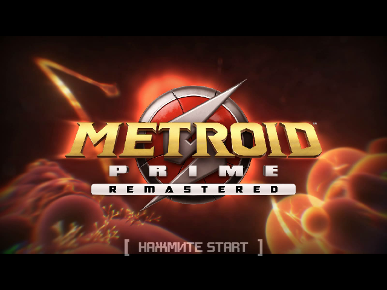
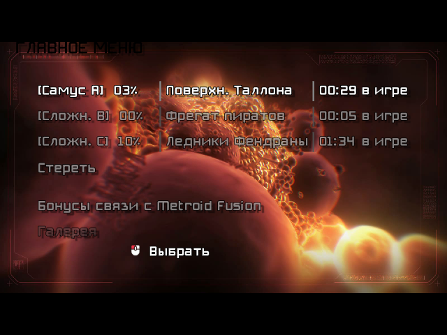
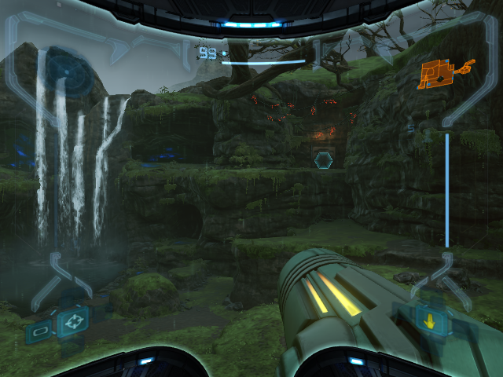
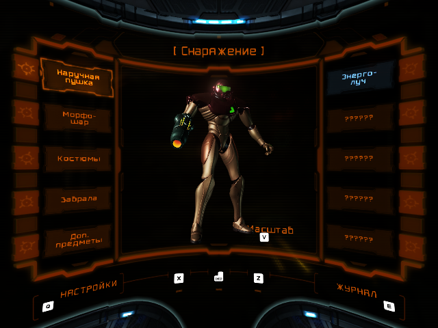
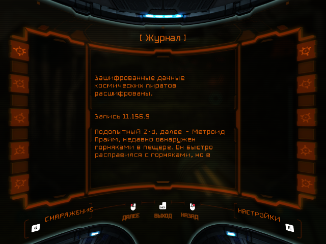
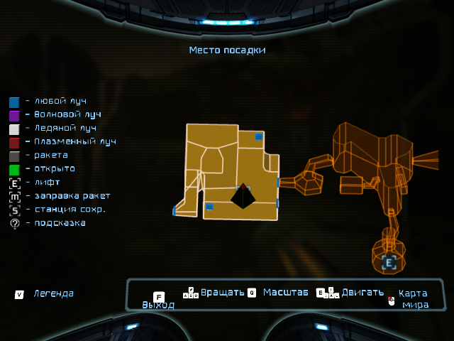

# Metroid Prime: русский перевод для нативного порта

Полный перевод Metroid Prime (GameCube, USA 1.00) для ПК/Android-порта
[Odrannnn/MetroidPrimePort](https://github.com/Odrannnn/MetroidPrimePort): меню, подсказки,
сканы, журнал и титры, все 2141 строка. В шрифты игры дорисована кириллица, надписи на текстурах
(«ЭНЕРГИЯ», «НАЖМИТЕ START», названия регионов в лифтах) перерисованы по-русски.

Перевод самостоятельный: сделан с нуля по английскому тексту игры, не основан на переводе
Mastertranslate и никак с ним не связан.

В репозитории нет данных Nintendo: мод собирается у каждого из его собственного диска.

| | |
|---|---|
|  |  |
|  |  |
|  |  |

## Что нужно
- порт [Odrannnn/MetroidPrimePort](https://github.com/Odrannnn/MetroidPrimePort/releases): последняя проверенная версия — **v0.44.0** (см. «Совместимость»). С v0.44.0 по-русски и строки самого порта: «Выйти из игры», его пункты в паузе, легенда карты; на старых версиях они остаются английскими. На более новых версиях перевод, скорее всего, тоже работает; если что-то сломалось, [откройте issue](https://github.com/454135431515/metroid-prime-ru/issues) с версией порта и логом;
- свой образ **Metroid Prime USA 1.00** (`GM8E01`, ревизия 0) в ISO; другие ревизии и PAL
  не поддерживаются;
- для сборки на Android или из исходников: Python 3 с пакетами Pillow и numpy
  (`pip install Pillow numpy`). На Windows, Linux и macOS Python не нужен, см. ниже.

## Совместимость
Последняя проверка: порт **v0.44.0**, 10 ноября 2026, — **пройдена**.
- Все 276 комнат загружаются: вылетов и ошибок загрузки ресурсов нет.
- Главное меню и «Выйти из игры» проверены в игре; пункты паузы и легенда карты — по ширине текста в
  шрифтах мода.
- Все проверки `tools/test.sh` прошли.

Известное: комната `83F6FF6F/3C785450` при автоматическом обходе иногда отвечает пустой ошибкой
перехода; прямой переход в неё работает, так было и на прошлых версиях порта.

## Установка без Python (Windows, Linux, macOS)
Мод собирается самим портом, из меню.
1. Скачайте архив импортёра для своей системы со страницы
   [Releases](https://github.com/454135431515/metroid-prime-ru/releases):
   `russian-importer-windows-x86_64.zip`, `-linux-x86_64.tar.gz` или `-macos-arm64.zip`.
2. Распакуйте файл `russian` (Windows: `russian.exe`) в папку `importers` рядом с папкой `mods`
   порта (создайте её; где лежит `mods`, см. ниже).
3. F1 → Mods: в списке импортёров у `russian` нажмите **Run**. Поле аргумента можно оставить
   пустым: импортёр возьмёт образ, выбранный в порте. Другой образ — укажите полный путь к `.iso`
   в этом поле.
4. После «Готово» перезапустите игру.

После обновления перевода нажмите Run ещё раз.

## Сборка из исходников
```sh
python -I tools/extract.py "Metroid Prime (USA).iso" work
python -I tools/build_mod.py work/res text/ru.json <папка mods порта>/russian
```

Сборка создаёт в папке `mods` две папки: `russian` (текст, шрифты, надписи на текстурах) и
`hud-russian` (кадры HUD). Нужны обе; если собирали в другом месте, скопируйте в `mods` обе.

Папка `mods` порта:
- Windows: `user\mods` рядом с `metroid_prime_port.exe`;
- Linux AppImage: `mods` рядом с файлом `.AppImage`;
- Android: `/storage/emulated/0/MetroidPrime/mods` (сначала F1 → System → Data folder →
  общая память).

Язык текста в настройках порта должен остаться английским (по умолчанию): перевод заменяет
английскую секцию.

Собранные папки на телефон удобнее возить одним zip и распаковывать на месте: тысячи мелких файлов
по MTP копируются плохо.

### Remastered
Импорт Remastered (`remastered-models`) с этим переводом официально не поддерживается и не
проверяется. Для русского Metroid Prime Remastered есть отдельный перевод для ПК-порта
PrimeRecomp: [Metroid-Prime-Remastered-RU](https://github.com/454135431515/Metroid-Prime-Remastered-RU).

## Не выкладывайте собранный мод
Собранные папки `russian` и `hud-russian` содержат изменённые файлы игры (шрифты, интерфейс, таблицы строк).
Раздавайте этот репозиторий, а не результат сборки.

## Для разработки
Все проверки: `tools/test.sh` (нужен `work/` от `extract.py`). Тикеты лежат в `docs/tickets/`,
решения в `docs/adr/`, глоссарий в `text/glossary.md`.

## Лицензия
Код (`tools/`) под лицензией MIT, см. `LICENSE`. Перевод и глоссарий (`text/`) под CC BY 4.0,
см. `text/LICENSE`. Metroid Prime является товарным знаком Nintendo; проект с Nintendo не связан.

---

**English.** A complete Russian translation of Metroid Prime (GameCube USA 1.00) for the native
[MetroidPrimePort](https://github.com/Odrannnn/MetroidPrimePort) (compatibility checked on v0.44.0, which also lets the port's own strings be translated; if a newer port version breaks it, please open an issue). It is an independent translation made from scratch, not based on or affiliated with the
Mastertranslate translation. No Nintendo data is
included: put the importer from Releases into the `importers` folder beside the port's `mods`
folder and press F1 > Mods > russian > Run, or build the mod from your own disc with the two
commands above (Python 3, Pillow, numpy) and put the `russian` and `hud-russian` folders into
`mods`. The port's Remastered import is not officially supported; for Metroid Prime Remastered in
Russian see [Metroid-Prime-Remastered-RU](https://github.com/454135431515/Metroid-Prime-Remastered-RU)
(for PrimeRecomp). Code is MIT, translation text is CC BY 4.0.
